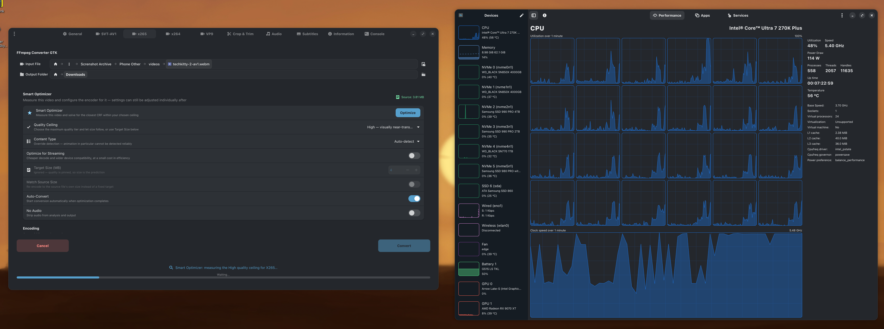

# SteamOS Vapor - Plasma 6.8

The KDE Plasma themes from SteamOS desktop mode (Vapor, Vapor for Steam Deck and
VGUI2 Classic), fixed and checked against Plasma 6.8.2, plus matching Konsole,
Alacritty and kitty colors.

Based on Valve's `steamdeck-kde-presets` 3.9.4-2 from the SteamOS 3.9 repository,
theme files only. SteamOS system files (configs, scripts, systemd units, Steam
shortcuts) are left out.

## What's in it

| Part | Path |
| --- | --- |
| Global themes: Vapor, Vapor (Steam Deck), VGUI2 Classic | `usr/share/plasma/look-and-feel/com.valve.*` |
| Vapor Plasma style | `usr/share/plasma/desktoptheme/Vapor` |
| Vapor and VGUI color schemes, plus Union versions | `usr/share/color-schemes` |
| Vapor GTK 3.24 theme | `usr/share/themes/Vapor/gtk-3.0`, `gtk-3.24` |
| Vapor GTK 4 theme, initial (plain GTK 4 apps; libadwaita apps ignore themes) | `usr/share/themes/Vapor/gtk-4.0` |
| Native libadwaita colors, installed by default since 1.0.4 | `libadwaita/vapor.css` |
| Vapor Konsole profile and colors | `usr/share/konsole` |
| Steam Deck wallpapers (`SteamDeckLogo` is the themes' default) | `usr/share/wallpapers` |
| Steam Deck start menu icon | `usr/share/icons/hicolor` |
| Vapor Alacritty colors | `alacritty/vapor.toml` |
| Vapor kitty colors | `kitty/vapor.conf` |

## What was fixed

The short version (details in [CHANGES.txt](CHANGES.txt)):

- VGUI splash screen ported from Plasma 5 code that no longer works.
- Global themes no longer reset your Alt+Tab switcher to one that Plasma 6 removed.
- Dead Plasma 5 settings removed.
- Wallpaper set the Plasma 6 way, so it works from `~/.local/share` too.
- VGUI: readable error/warning/success colors, and toolbars no longer turn
  Breeze grey when a window loses focus.
- Plain Vapor gets the Steam Deck splash.
- GTK 3.24: maintained stylesheet and standard theme-chooser entry, fixed
  inactive text selections, unused images removed, no startup warnings or blank
  hovered partly-checked checkboxes. GTK 2 support dropped.
- Konsole, Alacritty and kitty: black is a visible dark grey instead of the background color.

## Install

Arch: AUR package `plasma6-themes-steamos-vapor-fixed`, or build it from
[aur/PKGBUILD](aur/PKGBUILD) with `makepkg -si`.

Manually, for your user only: copy the folders under `usr/share` into
`~/.local/share` (for example `usr/share/plasma/look-and-feel/*` into
`~/.local/share/plasma/look-and-feel/`). For the whole system, copy `usr/share`
into `/usr/share`.

Then pick a global theme in System Settings > Colors & Themes > Global Theme.

Since **1.0.4**, the package includes native libadwaita colors, the
`vapor-libadwaita` helper and Plasma login integration. When the GTK application
theme is **Vapor**, the colors activate at the next Plasma login. Run
`vapor-libadwaita auto` to apply the current selection immediately, then restart
GTK 4 apps. `vapor-libadwaita disable` turns it off and remembers that choice;
`vapor-libadwaita enable` restores it. See [LIBADWAITA.md](LIBADWAITA.md).
For a per-user manual installation from this checkout, also run
`python3 -I tools/vapor-libadwaita enable`.

### Using Union

The global themes keep the classic Breeze app style, since Plasma's Union style
engine is still in development and meant to be picked by the user. If you switch
apps to Union (System Settings > Colors & Themes > Application Style), also pick
**Vapor Union** or **VGUI2 Classic Union** under Colors. They are the same schemes
tuned for how Union Breeze uses colors:

- Union draws the keyboard focus ring at 30% strength, which was barely visible
  with Vapor's and VGUI's focus colors. Brighter focus colors make it a bit more
  visible than Breeze Dark's.
- VGUI Union uses dark text on the gold selection (white was 3.5:1, now 5:1).
  Union also uses the selection gold for checkbox fills and button borders, so
  the gold stays and the text changes.

Re-applying a global theme sets the plain Vapor/VGUI scheme again.

VGUI also uses the Plastik window decoration (`aurorae` package) and the
KDE_Classic cursor (`oxygen-cursors` package).

Alacritty: add the theme under `[general]` in `~/.config/alacritty/alacritty.toml`:

```toml
import = ["/usr/share/alacritty/themes/steamos-vapor.toml"]
```

kitty (since 1.0.3): add near the top of `~/.config/kitty/kitty.conf`:

```conf
include /usr/share/kitty/themes/steamos-vapor.conf
```

Besides colors it sets the tab bar, split borders and highlight marks, and
redefines kitty's default hint shortcuts (Ctrl+Shift+E and Ctrl+Shift+P
keys) to draw Vapor-colored labels. Your own maps for those keys go after the
include. Set `background_opacity 0.9` yourself to match Konsole.

## GTK 3.24 compatibility

The working tree targets GTK **3.24** explicitly. Its maintained stylesheet lives
in `usr/share/themes/Vapor/gtk-3.24/gtk.css`; `gtk-3.0/gtk.css` imports it for
standard theme choosers and direct CSS consumers. The obsolete GTK 3.18/3.20
copies are removed. GTK 3.24 is supported since v1.0.2; a separate, initial GTK 4
theme ships since v1.0.3 (below). GTK 2 is not supported.

Vapor keeps its own styling and artwork. Its GTK selection blue/text now match
Vapor.colors (#569fcc / #1f1f26), including related accents and check/radio
artwork. It does not import Breeze GTK.
The previous gtk-3.20 stylesheet already worked under GTK 3.24; this update
makes the supported target explicit and fixes selectors that missed their
intended nodes. See [GTK3.md](GTK3.md) for validation, limits and check commands.

These changes are in release **1.0.2** and later (AUR `plasma6-themes-steamos-vapor-fixed`
1.0.2-1). When replacing an existing manual installation, replace the entire `Vapor` theme
folder rather than merging it, so obsolete versioned styles do not remain.

## GTK 4 (initial, since 1.0.3)

Release 1.0.3 ships an initial native GTK 4 theme, with a separate
`gtk-4.0/gtk.css` and explicit dark entry. It preserves Vapor's palette and shared
artwork and has isolated native-widget/parser checks on GTK 4.24.1. Native
libadwaita color support is included separately starting with 1.0.4. Broader
application coverage remains under validation.

[gtk4port.md](gtk4port.md) records every implementation step, failed experiment,
correction, test result, remaining gap and next step. [audit.md](audit.md) is the
initial assessment and subsequent reviews. To run the two independent toolkit checks:

```sh
python3 -I tools/check-gtk3.py
python3 -I tools/check-gtk4.py
```

Both checkers also run inactive-label contrast and spin-background regressions.
The GTK 4 checker runs all ten installed Widget Factory application cases,
repeats plain GTK checks with the libadwaita overlay present, and runs native
libadwaita, reversible-activation, broken-profile and package-staging checks
automatically.
Failures and missing dependencies fail the standard suite; no automatic skip.
The GTK 3 checker additionally needs `python-pillow`. To prove the tests reject
the original bugs on both toolkits, run:

```sh
python3 -I tools/test-gtk-regressions.py
```

The GTK 4 checker needs `gtk4` **4.24 or later** (with gtk4-broadwayd, headers and
pkg-config files), `gtk4-demos`, `pkgconf`, a C compiler, `dbus-run-session`,
`python-gobject`, `python-pillow`, `libadwaita` **1.10 or later** with Adw GI data,
and fonts. All display/config/output state is
temporary; `--output /tmp/vapor-gtk4-preview` retains widget screenshots at the
top level, behavior evidence under `behavior/` and application evidence under
`widget-factory/`. Overlay coexistence evidence is under `coexistence/` and
native Adw evidence under `libadwaita/`. A supplied `--theme` is used by the plain
GTK stages; `--libadwaita-profile FILE` selects the color profile to test.

To run only the **GTK Widget Factory** application stage:

```sh
python3 -I tools/check-widget-factory.py --output /tmp/vapor-widget-factory
```

This application check drives the installed binary's three pages on a private
display with temporary theme/config copies. Ten cases check normal and dark requests,
synthetic inactive states and right-to-left layout, saving content screenshots,
logs and a `results.json` report. Theme discovery, selection colors and nonblank
rendering are asserted. No desktop input or application actions are invoked.
Use `--quick` for just the three normal pages.

GTK 4.24.1 emits a Broadway frame-timing warning on page 3 even with a minimal
stylesheet containing no Vapor rules. That exact warning is retained and counted;
all other diagnostics fail the check. `--strict` rejects it too. This is a
content-rendering smoke test, with the application's own CSS still loaded; it
does not replace the widget behavior tests above or manual interaction checks.

Manual validation (2026-10-30): the user tested Widget Factory on a 4K monitor
at **175% scaling** and reported that everything looked correct. This records a
successful visual check for that configuration; automated checks remain at scale 1.

Released in 1.0.3 as initial support. Broader focus/popup interaction, other
scaling/display configurations, accessibility, animation/performance and wider
application coverage still need validation. The normal GTK theme applies to
plain GTK 4 apps; libadwaita uses the separate color profile below.

## Libadwaita colors (since 1.0.4)

The standard installation includes a native libadwaita profile that matches
Vapor's dark surfaces and accent/text pair while retaining Adwaita's layouts.
It preserves light/high-contrast styling and existing KDE user CSS. It requires
Python 3, GTK 4.24+ and libadwaita 1.10+, supplied as package dependencies.

From the checkout, preview activation with
`python3 -I tools/vapor-libadwaita enable --dry-run`. Explicit enable/disable,
requirements and limits are in [LIBADWAITA.md](LIBADWAITA.md). The packaged
login action applies the current GTK theme choice once per session; it does not
run a background watcher. Selecting another GTK theme removes the managed
overlay at the next login or `vapor-libadwaita auto` run.

The standard suite includes 22 native Adw cases, 28 activation/recovery tests,
15 deliberately broken-profile tests and eight package-staging tests. Surface
checks read rasterized widget backgrounds; focus contrast uses the adjacent
background in the captured image. Matching Adwaita demo and independent
GNOME Font Viewer startup checks also pass. Live fractional scaling, broader
app/accessibility/performance testing and Flatpak remain separate validation.
See [audit.md](audit.md), [libadwaita-plan.md](libadwaita-plan.md) and
[gtk4port.md](gtk4port.md) for evidence and remaining work.

Manual testing, **2026-10-30**: FFmpeg Converter GTK (left) and Mission Center
(right) with the Vapor libadwaita overlay enabled. The user reported both looked
good. This screenshot records the live appearance during testing.



## License

The theme files are Valve's, shipped by Valve under the GPL (GPL-2.0-or-later
per the package and global themes; the Vapor Plasma style's metadata says GPL
version 3). Steam, Steam Deck and their logos are trademarks of Valve
Corporation. This is an unofficial repackage, not affiliated with Valve.
