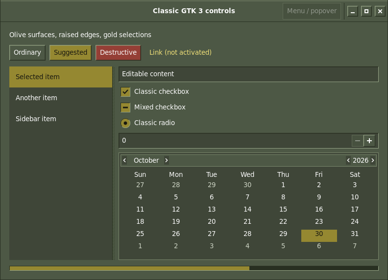
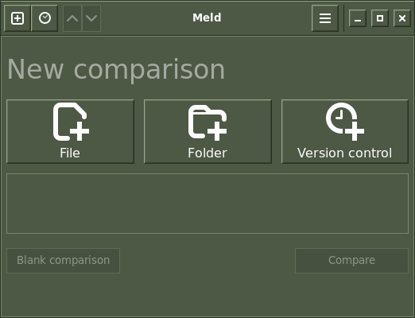
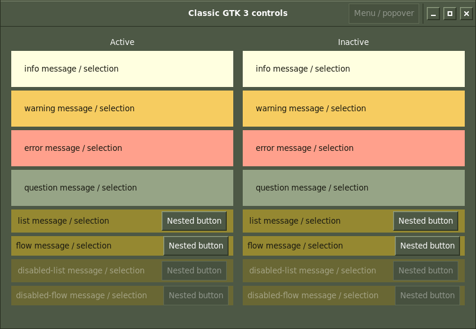
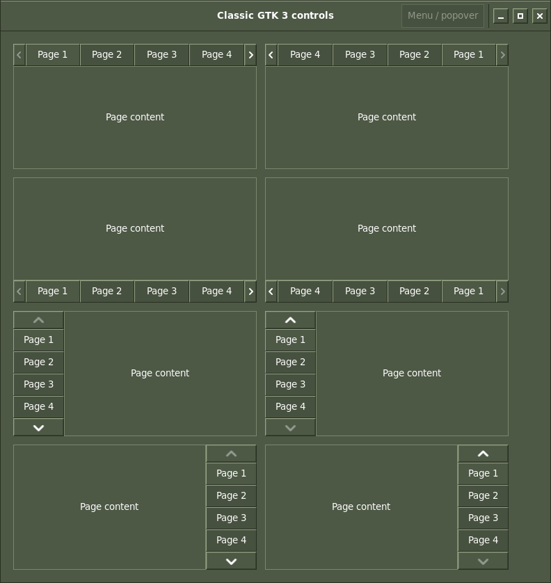
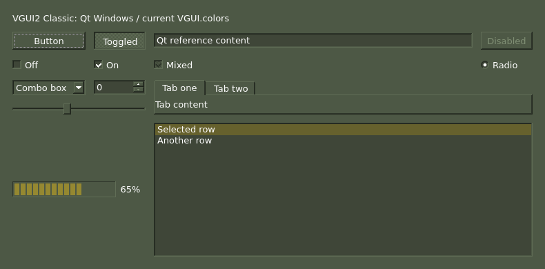

# VGUI2 Classic for GTK 3.24

Status: **initial implementation audited and corrected, unreleased**, 2026-10-30. The published
1.0.4 AUR package does not include this theme. GTK 4 and the VGUI2 libadwaita
profile remain planned in [vgui2-plan.md](vgui2-plan.md).

The independent **VGUI2Classic** theme matches the olive/gold KDE palette with
square raised/sunken controls. It keeps system fonts and normal GTK control
targets. The Qt Windows reference informed the appearance; GTK retains its own
spacing and uses readable dark foregrounds on opaque gold.



## Palette and controls

| Role | Value / treatment |
| --- | --- |
| Window/button | `#4d5845` |
| Content | `#3f4638` |
| Ordinary text | `#fcfcfc` |
| Secondary text | Readable olive-tinted `#cbd2c2` |
| Opaque selection/suggested/checked | `#958831` with `#181810` text |
| Dimmed text selection | Half-strength gold with light text |
| Focus / link | Pale `#ffffe0` focus on dark surfaces, dark `#181810` on opaque gold; `#f0e078` links |
| Deep trough/shadow | `#282f21` |

The selection foreground follows the readable VGUI Union value; light classic
Qt selection text has lower contrast on gold. Qt schemes and the selected Qt
style remain unchanged. Error/warning/success roles use the audited VGUI colors;
destructive buttons use a darker red fill with light text.

The theme provides buttons/toggles, entries, checked/mixed/radio controls,
switches, scales, horizontal/vertical spins, notebooks, lists/tree views,
sidebars, scrollbars, progress/level bars, menus/popovers, headers, tooltips,
calendar, info bars and client-side title buttons. Six new SVG glyphs replace
the need for Vapor's bitmap indicator set. CSS paints their fields and beveled
edges, so normal/hover/disabled states and scale-2 contexts remain scalable.
No Vapor artwork is edited or imported at runtime; GTK 2 is not provided.

## Preview and verification

Run the standard GTK 3 checks from this checkout:

```sh
python3 -I tools/check-gtk3.py --output /tmp/steamos-gtk3
```

The default command now runs **both Vapor and VGUI2Classic**. It includes
parser/asset checks, actual named-theme discovery and identical dark-entry
fallback, six widget states, 28 1x/2x indicator renders, inactive-label/spin
behavior, mapped windows/dialogs/popovers/menus/file choosers and 23 deliberate
VGUI2 regressions. Target one family with `--family vapor` or `--family vgui2`;
`--theme PATH` validates an explicit copy without recursively running mutations.

VGUI2 also checks 24 actual message/selected-container label states, 20 painted
focus cases and eight mapped notebook layouts (top/bottom/left/right in LTR/RTL).
The notebook check confirms actual internal nodes and compares their rendered
arrow styles against the correct symbolic icons. Indicator checks compare
glyph painting to the empty field and distinguish mixed from checked artwork;
a nonblank background alone cannot pass. Vapor retains its eight indicator cases.

Dependencies: GTK 3.24/broadwayd, Python GI, pycairo, Pillow, SVG support
(librsvg), dbus-run-session and fonts. A test-only GTK 3 protocol client gives
the private display a viewport and replies to surface messages. It sends no
desktop keyboard/mouse input. Native images use GTK/Cairo drawing.

Additional installed-application check, requiring Meld:

```sh
python3 -I tools/check-gtk3-windows.py --family vgui2 --meld \
  --output /tmp/vgui2-gtk3-apps
```

This opens Meld with private HOME/XDG settings and a service-free session bus,
captures its startup page and exits. It opens no comparison inputs or user
files. Its package version during testing was **3.24.1**.



For source-only, per-user experimentation, the theme folder can be copied to
`~/.local/share/themes/VGUI2Classic`. A fresh GTK 3 process launched with
`GTK_THEME=VGUI2Classic` can preview it without changing the global theme.
The automated commands above do not require that copy or change live settings.
The current libadwaita manager still supports Vapor only; shared VGUI2 profile
activation belongs to the later libadwaita stage.

## Recorded results and limits

GTK **3.24.52** passes with no unexpected diagnostics. Sampled solid-gold text
is **4.965:1**, ordinary/secondary/entry text **7.317 / 4.839 / 9.545:1**,
unvisited links **5.590:1**, destructive action text **6.728:1** and progress
fill/trough **3.848:1**. Painted synthetic focus checks cover normal and selected/
pressed/hovered controls, including icon views and compatibility menu buttons.
The lowest measured ratio is **3.506:1**, on gold; the original seven normal
cases remain at least **5.040:1**. These are fixture measurements, not a whole-app
accessibility or keyboard-interaction certification.

The follow-up audit fixed inactive warning/error text (previously 1:1), nested
button labels inside selected rows (2.377:1), inactive selected FlowBox labels
(3.503:1), weak focus on gold (2.717:1), missing focus paths and sideways vertical
notebook arrows. Plain selected labels inherit dark text, while nested controls
retain their own foregrounds and disabled labels remain dimmed. See the latest
entries in [audit.md](audit.md) and [gtk4port.md](gtk4port.md), section 23.





Both normal and dark entries load the actual VGUI2Classic theme. All 23 broken
copies fail their intended palette, surface, backdrop, focus, bevel, artwork,
label, spin, parser, notebook or entry-point gate. The six original Vapor
GTK 3/4 mutation checks still pass. All **14** original Vapor GTK 3 images remain
byte-identical to the previous checker. The full GTK 4/libadwaita suite passed
at the initial port; this audit rechecked its original regression controls and
verified those production files are unchanged.

The 2x checks exercise scaled indicator contexts; whole-window HiDPI,
fractional scaling, live Wayland/X11, full keyboard navigation, accessibility
tools and performance need further validation. The successful Vapor 4K/175%
result does not establish VGUI2 coverage. GTK 4, libadwaita VGUI2 switching and
Flatpak support are separate work. No release or live activation is included.

Portable results: [vgui2-gtk3-validation.json](docs/audits/vgui2-gtk3-validation.json).
Source investigation: [vgui2-audit.md](vgui2-audit.md). Work sequence and corrected
test-harness experiments: [gtk4port.md](gtk4port.md), section 22.

Fresh Qt reference, rendered offscreen with Qt Windows and KColorScheme using
the unchanged VGUI.colors:



The palette/style reference is Valve's; the tested state fixes build on this
project's maintained Vapor engineering. The standalone CSS and new SVG glyphs
are distributed under GPL-2.0-or-later, consistent with the theme package.
