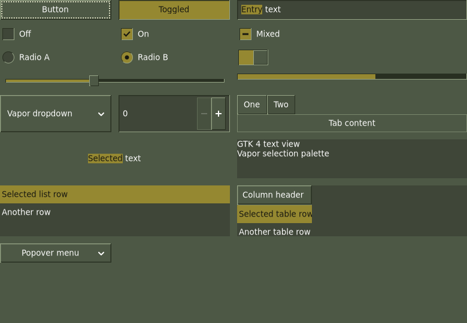
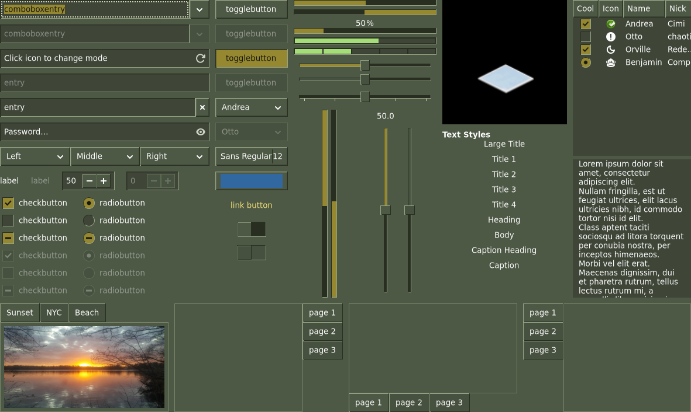
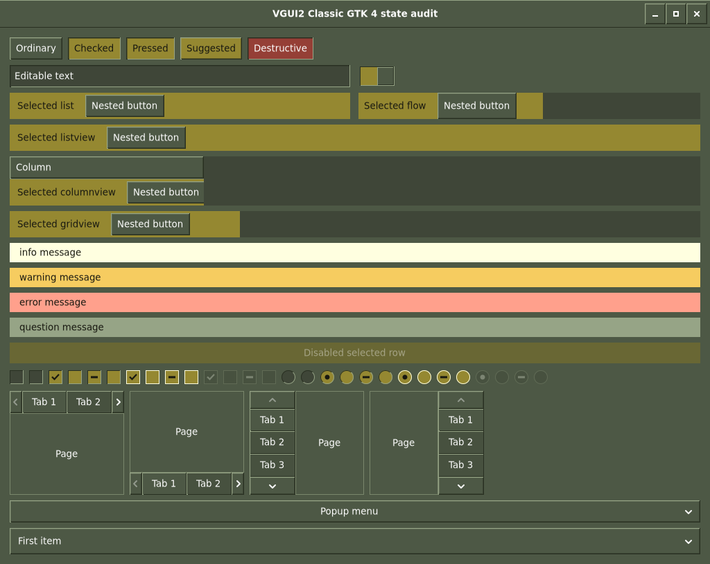
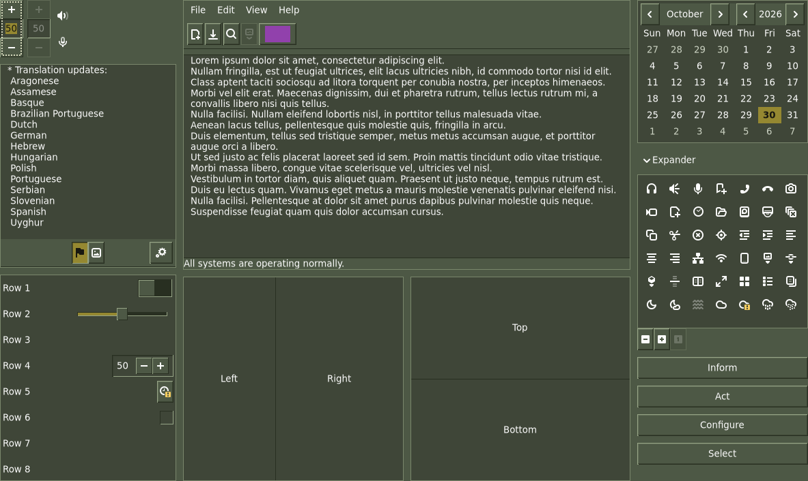

# VGUI2 Classic for plain GTK 4

Released in **1.1.0**: installed by default with matching automatic libadwaita
selection. See [LIBADWAITA.md](LIBADWAITA.md) for upgrades, disable and switching.

Status: **initial implementation audited and corrected, released in 1.1.0**, 2026-10-30. Tested with
GTK **4.24.1** on Plasma **6.8.2**. Packages before **1.1.0** do not include this family. The matching [native libadwaita color profile](VGUI2-LIBADWAITA.md)
is implemented and tested; shared activation ships in 1.1.0, as recorded in
[vgui2-plan.md](vgui2-plan.md).

The standalone `VGUI2Classic/gtk-4.0` stylesheet matches the audited
[GTK 3 design](VGUI2-GTK3.md): olive surfaces, square raised/sunken edges,
gold selections with dark text, scalable check/radio glyphs and visible focus.
It preserves the user's font preferences. Normal and dark requests use the
same dark olive palette through explicit normal/dark entry files.



## GTK 4 adaptation

The GTK 4 file is independent at runtime: it imports neither GTK 3 nor Vapor.
It reuses the family's six audited SVG glyphs without modifying them. Toolkit
adaptations include:

- `text` children inside entries and horizontal/vertical spins, with focus on
  the outer field and no duplicate inner border.
- Grouped check buttons for radio indicators; normal, checked, mixed, hover
  and disabled glyphs remain distinct at integer scales 1 and 2.
- DropDown popovers and ListView/ColumnView/GridView selection paths. Nested
  buttons retain their own foregrounds while selected plain labels stay dark.
- Popover `contents` surfaces and observed `modelbutton.flat` menu nodes.
- GTK 4 calendar grid labels, header controls, window controls and icon filters.
- GTK 4 frame/scrolled-frame borders, inset vertical spin fields, requested
  column/row separators and direction-aware collapsed/expanded expander arrows.
- Two-pixel dotted focus, pale on olive/red and dark on gold. The GTK 3 thin
  outline rendered at only 2.73:1 on an ordinary GTK 4 button; the wider outline
  passes the same 3:1 gate without changing allocations.
- Notebook overflow buttons with image children. Directional symbolic images
  are painted on the button, with its native image hidden to avoid duplicate
  or sideways glyphs. Native button geometry and navigation remain intact.
- Reduced-motion handling for animations. No service or background watcher.

The reference roles remain window/button `#4d5845`, content `#3f4638`, ordinary
text `#fcfcfc`, selection `#958831` with `#181810` text, and secondary text
`#cbd2c2`. Semantic message fills retain readable dark text in inactive windows.

## Standard checks and evidence

```sh
python3 -I tools/check-gtk4.py --output /tmp/steamos-gtk4
```

The default command validates **both families**. Vapor retains its native,
Widget Factory, overlay coexistence, libadwaita, activation/recovery and mutation
stages. VGUI2 adds its own native, shared behavior, Widget Factory, real-widget
state matrix and **32** deliberate regression controls, plus matching-profile
coexistence, 34 Adw surface cases, 12 real-control cases and 25 Adw regressions. A missing application,
parser error or failed assertion fails the suite.

To target VGUI2 alone:

```sh
python3 -I tools/check-gtk4.py --family vgui2 --output /tmp/vgui2-gtk4
```

`--theme PATH` checks an explicit copy without recursively running mutations.
The installed Widget Factory is a separate real application, driven by a
temporary helper loaded only into that private test process. Its ten cases
cover all three pages with normal/dark requests and backdrop, plus page-one RTL.
It opens no user files or device-changing actions.

The audit found that setting the interface color preference did not select the
legacy dark entry on this GTK build. Tests now request the named normal/dark
variant explicitly in each private process and verify a marker present only in
the dark entry. A broken dark file is rejected. No desktop setting is changed.



The additional fixture runs normal, dark, synthetic backdrop, RTL and actual
scale-2 windows. Each case covers 20 label samples, nine painted focus cases,
14 indicator states, four notebook positions/eight arrows, a menu, a dropdown
and a native file chooser. Five cases total 100 label checks, 45 focus checks,
70 indicator renders and 40 arrow comparisons. Disabled text is checked for
dimming rather than held to the enabled-text contrast gate.

The follow-up audit adds **60** control checks across those cases: frame and
optional scroll-frame borders, horizontal/vertical/disabled fields, separator
and padding behavior, expander glyphs and paired native title-focus captures.
It also checks **15** actual text selections, selecting label, entry and text
view separately so primary-selection ownership cannot clear another fixture.

Label contrast uses actual adjacent painted backgrounds. Enabled samples pass
4.5:1; opaque gold text is 4.965:1, ordinary text 7.317:1 and error/warning
messages 9.056/11.661:1. Focus uses changed outline pixels and a 3:1 gate;
the original nine focus cases remain above 3:1. Transparent snapshots are
composited over the sampled real parent fill before measuring the outline.
Expander title focus uses paired native widgets with synthetic state; full
keyboard interaction remains outside this fixture.
Arrow glyphs are compared against independent symbolic-icon renders using
glyph support, allowing antialiasing differences at 1x/2x. A wrong-direction
mutation must fail that gate. Check/radio tests compare glyphs with explicit
empty references and require checked/mixed artwork to differ.



The fixture deliberately pairs indicators with empty references; those blank
fields are test controls. All test HOME/XDG directories, D-Bus and displays are
temporary. The transport client acknowledges frames without desktop input;
exported images use native GTK/GSK snapshots rendered through Cairo.

GTK 4.24.1 Broadway emits two timing messages under dynamic focus/popup tests.
Both were reproduced with stock GTK and no project theme. The runner retains
and counts only those exact messages; `--strict` on the state checker rejects
them too. CSS diagnostics and other warnings always fail. Widget Factory's
existing timing-warning policy is unchanged.

The full existing Vapor GTK 4/libadwaita suite passes. Of 172 captures from the
earlier session, 171 remain byte-identical; one application's image region in
Widget Factory differs. A fresh frozen original runner produces all ten factory
images identically to the current runner, including that region. Production
Vapor and GTK 3 files remain hash-identical. The existing Vapor libadwaita overlay leaves
plain VGUI2 GTK 4 captures unchanged in a separate coexistence run.



Audit fixes and before/after evidence are recorded in [audit.md](audit.md) and
[gtk4port.md](gtk4port.md), section 25. The earlier port measurements in section
24 are historical. Tests retain worker logs even if transport teardown fails;
this audit's display client also paces acknowledgements to avoid a busy frame
clock. Other test clients and production theme behavior are unchanged.

Portable results: [vgui2-gtk4-validation.json](docs/audits/vgui2-gtk4-validation.json).
The work record is [gtk4port.md](gtk4port.md), sections 24–25; current findings are
in [audit.md](audit.md).

## Preview scope and remaining work

A source-only preview can use a copy of `usr/share/themes/VGUI2Classic` under
`~/.local/share/themes`, then launch a fresh plain GTK 4 process with
`GTK_THEME=VGUI2Classic`. The automated checks do not require that installation
and do not change the active desktop theme.

This guide covers plain GTK 4 support. VGUI2 libadwaita colors are now covered
by [their separate guide](VGUI2-LIBADWAITA.md). Shared profile switching
ships in 1.1.0 and follows the actual GTK theme. Widget Factory
provides actual application evidence, while broader app workflows, live Wayland/
X11, fractional scaling, full keyboard/screen-reader testing, Flatpak and
comparative performance measurements remain open. Integer scale-2 coverage
does not establish fractional scaling. Package installation does not change the
GTK selection or write user configuration. CSS and glyphs remain GPL-2.0-or-later.

The Adw follow-up audit adds local `--vgui2-classic-focus-color` values beside
the existing focus colors. These variables preserve the original dotted focus
when the user profile is loaded; they do not alter standalone theme rendering.
The standard suite now repeats the five deeper state/focus cases with that
profile present and rejects a private copy with the bridge removed.
