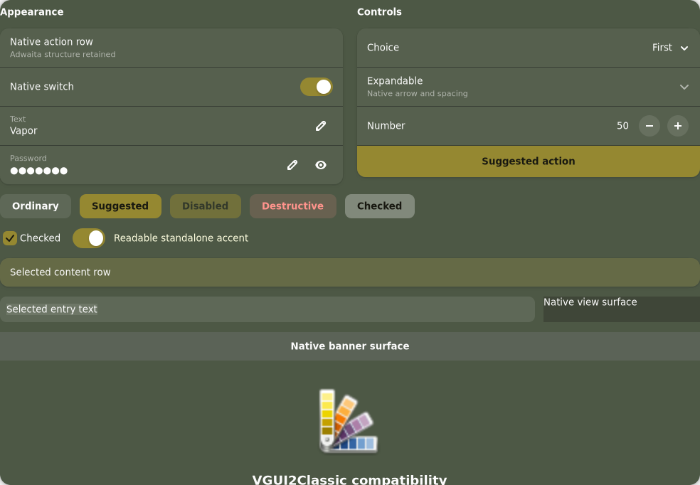
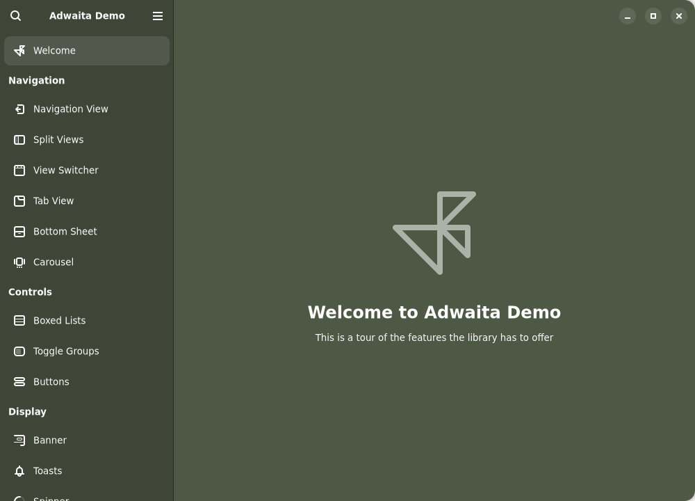
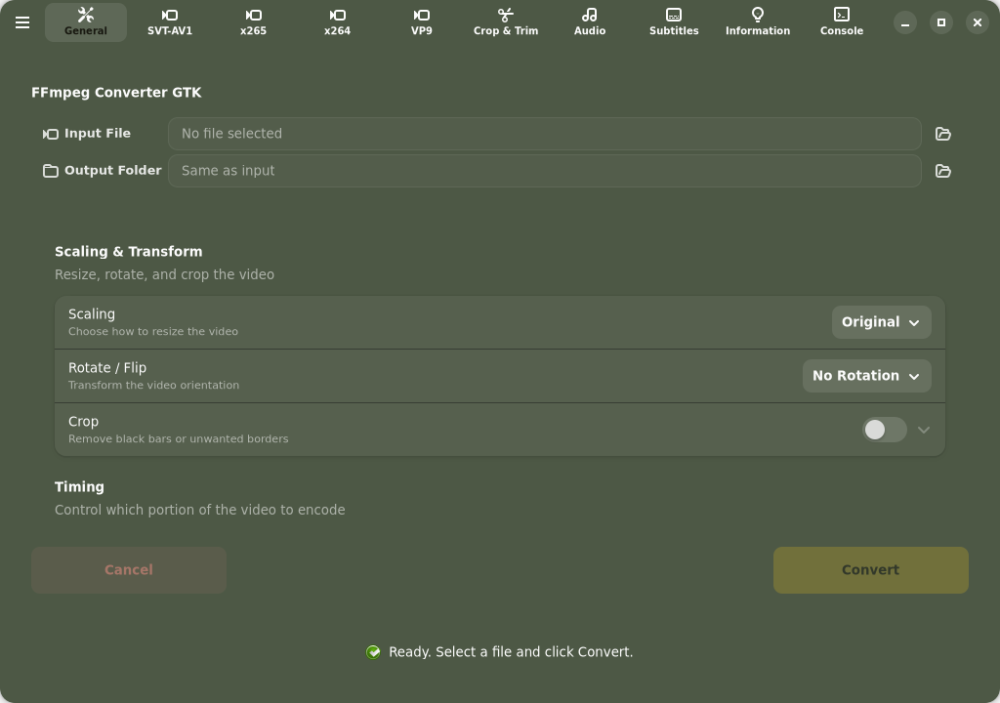

# VGUI2 Classic colors for libadwaita

Status: **initial color profile audited and corrected, unreleased**, 2026-10-30.
Tested with libadwaita **1.10.0**, GTK **4.24.1** and Plasma **6.8.2**.
The published AUR 1.0.4 package does not include this profile.

`libadwaita/vgui2.css` matches the VGUI2 Classic olive/gold palette while
retaining Adwaita's widget shapes, spacing and responsive layouts. It applies
only to **dark appearance with normal contrast**. Light and high-contrast
appearances retain upstream styling; the profile does not force dark mode.



## Colors and focus

| Role | Color |
| --- | --- |
| Window, header, dialog, popover | `#4d5845` |
| View and primary sidebar | `#3f4638` |
| Secondary sidebar | `#282f21` |
| Raised card and thumbnail | `#56604e` |
| Ordinary foreground | `#fcfcfc` |
| Solid selected/suggested fill | `#958831` |
| Foreground on solid gold | `#181810` |
| Standalone accent and focus source | `#ffffe0` |
| Ordinary checked-toggle label and inset focus | `#181810` |

The profile sets 28 color roles and three private coverage/ink controls. The
separate pale accent keeps standalone text readable without brightening the
original solid gold selection. Ordinary button focus uses 65% coverage; checks,
switches, entries and spins use 80%, preserving outline width/offset/shape.
The initial button-only rule missed weak input focus and changed compound
destructive buttons; the audit corrected both.

Checked and activated button labels use dark ink while the button keeps its native gray fill.
The same dark ink makes its inset focus readable, including hover/pressed and keyboard-activation
states. Tested checked text and focus measure **4.93–6.58:1**, versus checked
text as low as **2.64:1** before the fix. Nested labels are covered too.
Semantic classes inherit native coverage/ink through compound controls, so
their native outlines and semantic foregrounds remain unchanged.
Adwaita helper opacities, semantic role variables, fonts and motion are unchanged.

The bundled plain GTK 4 theme supplies local focus colors that this profile
honors. This prevents its solid focus colors from weakening the classic theme's
dotted focus on gold controls. Deeper coexistence checks cover five plain-GTK
state/scaling cases, including real focus. This is tested with the bundled
VGUI2Classic theme; it is not a guarantee for arbitrary third-party GTK themes.

This uses libadwaita's documented [color roles](https://gnome.pages.gitlab.gnome.org/libadwaita/doc/1.10/css-variables.html)
and [appearance behavior](https://gnome.pages.gitlab.gnome.org/libadwaita/doc/1.10/styles-and-appearance.html).
CSS changes do not replace the system-accent API. Apps that draw their own
graphs or use hardcoded colors can retain different accents.

## Preview and tests

From a source checkout, run isolated tests with temporary user configuration:

```sh
python3 -I tools/check-libadwaita.py --family vgui2 --output /tmp/vgui2-adwaita
python3 -I tools/check-vgui2-libadwaita.py --output /tmp/vgui2-adwaita-controls
python3 -I tools/test-libadwaita-regressions.py --family vgui2
python3 -I tools/check-gtk4.py --family vgui2 --output /tmp/vgui2-gtk4
```

The default `check-gtk4.py` runs both families, including matching-profile
coexistence, native Adw checks, deliberate regressions and package staging.
VGUI2 has 34 surface/appearance cases, 12 real-control cases and 25 deliberate
regression controls. The control fixture exercises 50 controls per case using
unfocused/focused pairs: dark/light, normal/high contrast, RTL and scale 2.
Its checks cover native inputs, preference rows, ordinary/flat/checked buttons,
nested labels, and direct/menu/split destructive buttons. Its additional focus
cases cover cards, views, sidebars, dialogs, popovers and menus. Tests sample
the actual adjacent surface, compare unrounded contrast and preserve baseline
geometry, semantic colors and system-accent API values. Light/high-contrast
profile images must exactly match their upstream baselines.

The optional application checker also accepts `--family vgui2`:

```sh
python3 -I tools/check-libadwaita-app.py --family vgui2 \
  --application /usr/bin/ffmpeg-converter-gtk \
  --app-id com.github.pieman.FFmpegConverterGTK --output /tmp/vgui2-converter
```

The libadwaita 1.10 demo passes isolated baseline/profile startup checks with
the final profile. FFmpeg Converter GTK passed after the main fixes; its final
activation-state retest is blocked by the stock GTK display failure described
below. The checker opens no media and sends no app
actions. These startup checks are additional evidence, not default dependencies.





## Packaging and activation boundary

The working stager includes the profile at
`/usr/share/steamos-vapor/libadwaita/vgui2.css`, together with this guide and
evidence. **Automatic VGUI2 activation is not implemented yet.** The existing
Vapor helper/login selection behavior remains as documented in
[LIBADWAITA.md](LIBADWAITA.md). Selecting VGUI2 alone does not activate this
profile. Do not use the Vapor-only automatic decision as a VGUI2 switcher.

Tests supply the new profile explicitly to the existing helper inside private
configuration directories. Shared profile selection, backup-preserving
migration and persistent disable tests are [stage 6](vgui2-plan.md) and must
precede a default-installation release. This milestone changes no live settings,
published version or AUR package.

## Evidence and remaining validation

[Portable results](docs/audits/vgui2-libadwaita-validation.json) record native
colors, rendered surfaces, focus measurements, fallback/geometry comparisons,
application checks and standard-suite results. [gtk4port.md](gtk4port.md),
sections 26–27, record implementation experiments and corrections.
[Audit evidence](docs/audits/vgui2-libadwaita-audit.json) includes the original
profile failures and corrected control measurements.

The private display uses Broadway and deterministic Cairo snapshots. Focus and
backdrop are synthetic. Live keyboard navigation, Wayland/X11 GPU rendering,
fractional scaling, accessibility tools, scrolling/resize performance and
Flatpak require separate validation. No speed improvement is claimed.
The extra 3:1 focus/4.5:1 text gates in the control fixture apply to ordinary
controls; semantic controls are checked against upstream styling. Preserving
those native semantic treatments does not establish full contrast conformance.
Application automation also encountered an intermittent private-display EOF in
an upstream baseline and the frozen original runner. The final converter retest
captures GTK's Broadway render-node assertion before any profile is applied;
the final demo pair passes. Failed runs are retained, with no retry or warning
suppression added.
