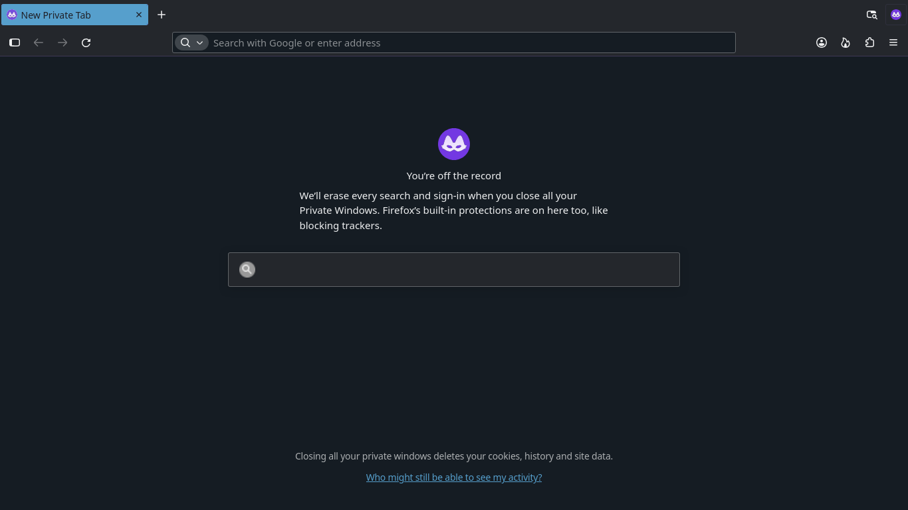

# Vapor for Firefox

The default setup applies Vapor colors **and Breeze-inspired controls** together.
It uses dark gray surfaces, blue selections and 3-pixel corners for tabs, fields
and buttons. Normal and private windows share the appearance; the private start
page also gets a matching background. Firefox retains its private-browsing badge,
security indicators, fonts and usable control sizes.

## Try the complete setup

The first build is **0.1.0**, checked against Firefox **159** on Linux. Open the
complete `vapor-firefox-0.1.0.zip` bundle, extract it, then open **Apply Vapor to
Firefox**. The setup window guides you through choosing Firefox's settings folder
and closing Firefox before applying the appearance.

Follow the [setup and removal instructions](INSTALL.md). This applies the whole
appearance by default; there is no separate Breeze-style option to turn on.
Your normal Firefox profile has not been changed during development/testing.

This setup uses Firefox's custom-style support. It adds owned imports to existing
appearance files and enables Firefox's stylesheet loader. Existing files and
unrelated settings are retained. The setup refuses an open profile or ambiguous
edited files and supports removing its own changes later. Firefox updates can
change internal styling, so later versions need ongoing checks.

To remove this appearance, use **Remove Vapor from Firefox** in the same setup
window. Choosing another color theme in Firefox's Themes page alone does not
remove the custom controls or page styling.

## Private windows

The tab strip, selected tab, toolbar, address field and private start-page
background match Vapor. Firefox's private-browsing badge and messages remain
visible. Native Firefox/brand artwork may retain its own colors. The setup does
not change how private browsing works or recolor ordinary websites.

## For maintainers: components and builds

- [vapor/userChrome.css](vapor/userChrome.css): default browser colors and
  Breeze-inspired control shapes, guarded for normal contrast.
- [vapor/userContent.css](vapor/userContent.css): matching Firefox-owned pages
  only, including the private start page; no arbitrary website styling.
- [../tools/vapor-firefox](../tools/vapor-firefox): setup/removal tool with a KDE
  dialog workflow and a command-line form for isolated tests.
- [vapor/manifest.json](vapor/manifest.json): separate static color component,
  with matching normal/dark variants. A normal color-theme XPI cannot carry the
  complete UI appearance. It is not the default end-user setup.

Build reproducible artifacts:

```sh
python3 -I tools/build-firefox-themes.py
```

The main output is `firefox/build/vapor-firefox-0.1.0.zip`, containing the
complete setup. The builder also creates an **unsigned color-component XPI**
for development. That XPI needs Mozilla signing before ordinary addon
installation; the default custom-style setup does not install it or weaken
signature checks. No appearance component runs a browser background script.

## For maintainers: tests

Browser checks require Python, [dev-requirements.txt](dev-requirements.txt),
Node.js 22+ and Mozilla `web-ext` **10.5.0**. Development tools stay outside the
user's runtime package. Example setup from the repository root:

```sh
python3 -m venv /tmp/vapor-firefox-tests
/tmp/vapor-firefox-tests/bin/python -m pip install -r firefox/dev-requirements.txt
npm install --prefix /tmp/vapor-firefox-validator --ignore-scripts web-ext@10.5.0
/tmp/vapor-firefox-tests/bin/python -I tools/check-firefox.py \
  --web-ext /tmp/vapor-firefox-validator/node_modules/.bin/web-ext \
  --output /tmp/vapor-firefox-results
```

Node must be on PATH for `web-ext`. `--firefox` accepts the actual Firefox
binary; the default `/usr/lib/firefox/firefox` suits this Arch installation.
Missing development tools fail clearly. `--quick` reports deliberately limited
coverage; the default checks both Firefox designs, light/dark system preferences
and scales 1/2. Profile-preservation tests can also run independently:

```sh
python3 -I tools/test-firefox-setup.py
```

Tests use fresh profiles and dedicated Firefox processes. They apply the
complete default setup, inspect native browser windows and private pages,
check shapes/colors/readability, reject edits to a live profile and test removal
through an actual browser restart. Wrong toolbar colors, unreadable selected
text, a purple private-window override and rounded private tabs must be detected.

The browser tests remove only Firefox's automation-cue attribute in their own
windows before measuring colors; stock and themed captures receive the same
adjustment. Native focus transitions finish before sampling. Private indicators
are retained. Automation access is enabled only in the test child process.

Current core results: eight configurations, 24 normal/private window
observations, 48 hover/pressed button checks, ten setup/recovery tests and four
UI regression controls. [Validation evidence](../docs/audits/firefox-vapor-validation.json)
records the actual colors, shapes, state checks and bundle hashes.

Firefox Home's React content also remains blank in an independent stock test
profile. Its background is checked, but its widgets are explicitly unverified;
this is recorded as a baseline limitation, not a full Home-page pass.

This is initial headless coverage. Live Wayland/fractional scaling, the wider
menu/sidebar/Settings matrix, forced colors and comprehensive accessibility or
performance testing still need work. See the [plan](../firefox-plan.md) and
[audit](../firefox-audit.md) for boundaries and evidence.

## Private-window preview



## License and attribution

GPL-2.0-or-later, consistent with the parent project; see [COPYING](COPYING).
Colors are based on Valve's SteamOS Vapor palette and this project's maintained
GTK/KDE schemes. This community appearance is maintained by orlfman.
